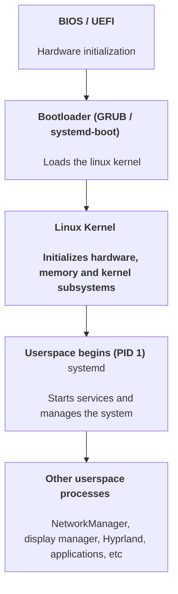

In Linux, **userspace** (also called user space) is the area of the operating system where ordinary applications and user-level programs execute.

Linux divides memory and execution privilages into two major areas:

1. Kernel space: Where the Linux kernel executes with privileged access to hardware and system resources.
2. Userspace - Where applications and system-level programs execute with restricted privileges.

A lot of things you use in Linux run in userspace:

| Component           | Examples         |
| ------------------- | ---------------- |
| Shell               | Bash, Zsh        |
| Terminal Emulator   | Kitty, Alacritty |
| Desktop environment | GNOME, KDE       |
| Window manager      | Hyprland, i3     |
| Init system         | systemd          |
| Service manager     | systemd          |
| Networking tools    | NetworkManager   |
| Applications        | Firefox, VS Code |
| System utilities    | grep, systemctl  |

Even [systemd](./systemd.md), which manages the boot process and system servieces, runs in userspace.

### How does userspace communicate with the kernel?

Userspace programs cannot directly access privilaged kernel functionality.

They communicate with the kernel through system calls (syscalls)

For example, consider this command:
```sh
cat /etc/hostname
```

What happens internally?
1. You execute `cat` in userspace.
2. `cat` requests the file contents using the system calls such as `openat()` and `read()`.
3. The kernel handles filesystem access.
4. The kernel returns the file contents to `cat`.
5. `cat` displays the contents in your command.

### What hapens during Linux boot?

A simplified Linux boot sequence:

BIOS/UEFI - hardware initialization -> 
Bootloader (GRUB / systemd-boot) - loads the linux kernel ->
Linux kernel - initalizes hardware


